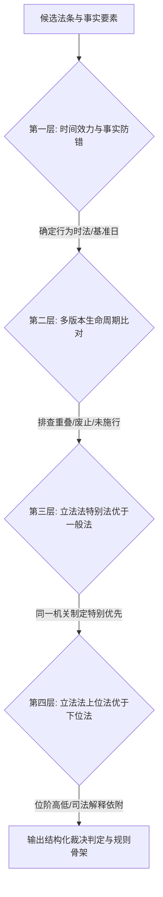
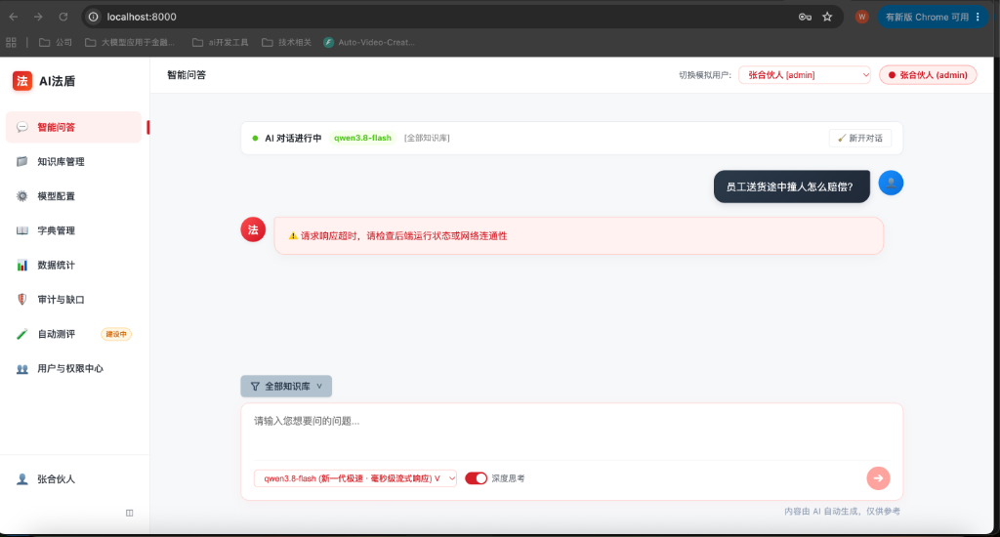
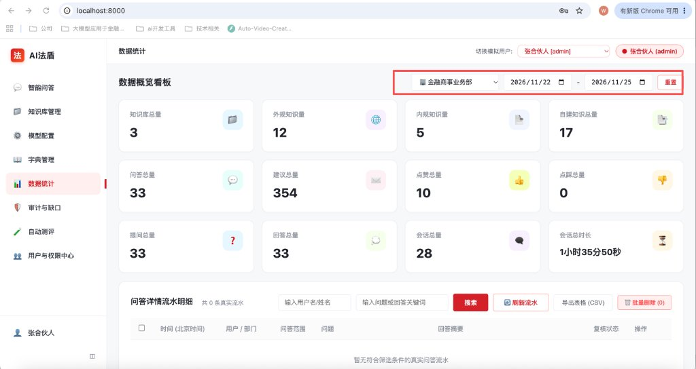
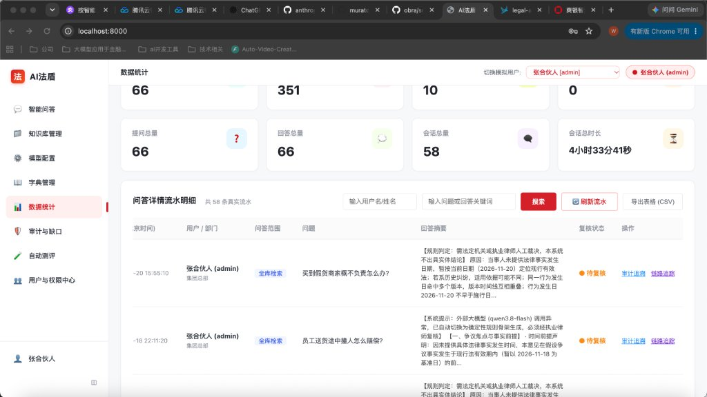
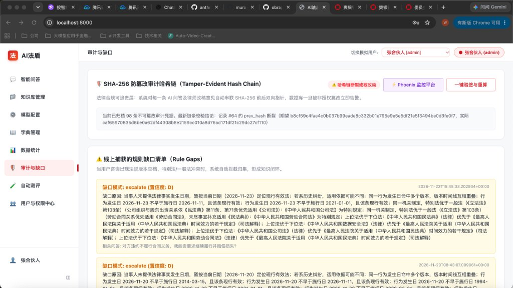
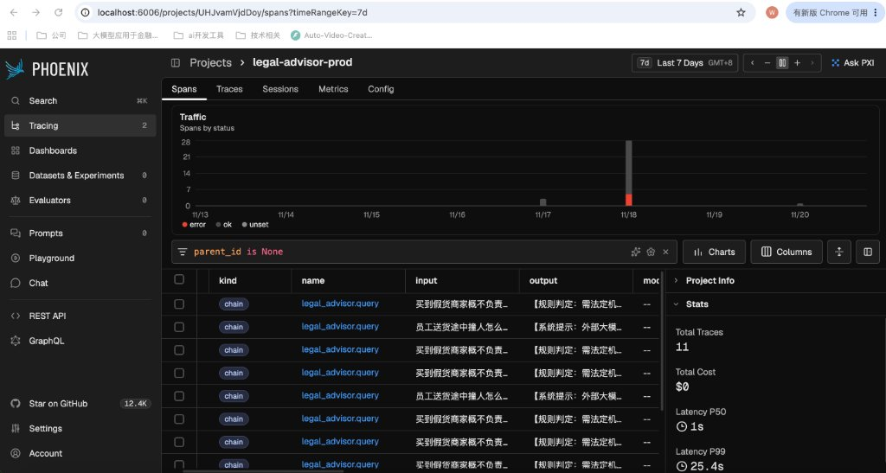
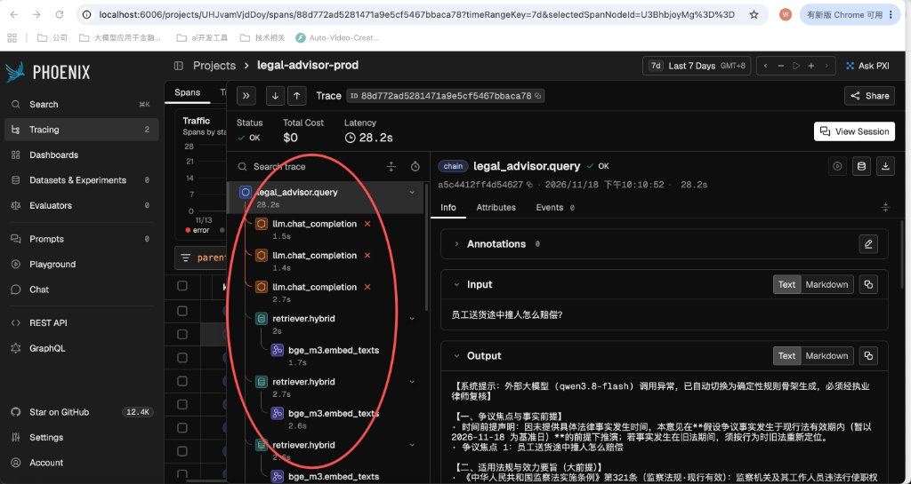
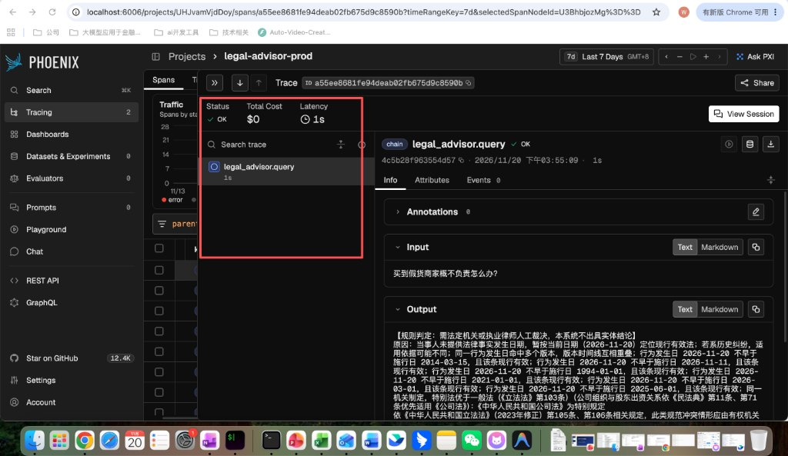

# ⚖️ AI法盾（Legal Advisor Agent）

> **企业级确定性法律顾问智能体与合规平台**  
> 基于 **LangGraph 状态机** 与 **LlamaIndex 双擎 RAG** 深度构建，融合 **确定性法理规则引擎** 与 **执业律师人在环（HITL）闸门**，严格满足法律实务中的 **「引用准确性、法规时效性、位阶层级裁决、两层结构化输出」** 四大核心刚性约束，并提供 **SHA-256 防篡改审计哈希链** 与 **Phoenix 全链路可观测性监控**。

---

## 📑 目录

- [一、 系统定位与四大核心法理约束](#一-系统定位与四大核心法理约束)
- [二、 法律问答核心业务逻辑与流转机制](#二-法律问答核心业务逻辑与流转机制)
  - [2.1 全生命周期架构全景](#21-全生命周期架构全景)
  - [2.2 阶段一：前置事实抽取与合规风控](#22-阶段一前置事实抽取与合规风控)
  - [2.3 阶段二：双擎融合检索与时效生命周期比对](#23-阶段二双擎融合检索与时效生命周期比对)
  - [2.4 阶段三：确定性法理规则引擎（四层级法理递进推演）](#24-阶段三确定性法理规则引擎四层级法理递进推演)
  - [2.5 阶段四：两层结构化输出与细粒度溯源](#25-阶段四两层结构化输出与细粒度溯源)
  - [2.6 阶段五：执业律师人在环审核闸门（HITL）](#26-阶段五执业律师人在环审核闸门hitl)
  - [2.7 阶段六：SHA-256 审计链归档与规则缺口闭环](#27-阶段六sha-256-审计链归档与规则缺口闭环)
- [三、 核心功能模块与界面全览（附系统截图）](#三-核心功能模块与界面全览附系统截图)
  - [3.1 智能问答与律师审核工作台](#31-智能问答与律师审核工作台)
  - [3.2 数据统计与概览看板（多维同频联动）](#32-数据统计与概览看板多维同频联动)
  - [3.3 问答详情流水明细与生命周期管理](#33-问答详情流水明细与生命周期管理)
  - [3.4 审计与缺口管理（防篡改哈希链 + 四层级缺口清单）](#34-审计与缺口管理防篡改哈希链--四层级缺口清单)
  - [3.5 全链路可观测性（Phoenix 分布式链路追踪）](#35-全链路可观测性phoenix-分布式链路追踪)
- [四、 提示词体系与配置解耦机制](#四-提示词体系与配置解耦机制)
- [五、 快速启动与环境部署](#五-快速启动与环境部署)
- [六、 知识库规范与元数据体系](#六-知识库规范与元数据体系)
- [七、 自动化评测与质量保障](#七-自动化评测与质量保障)

---

## 一、 系统定位与四大核心法理约束

通用大语言模型（LLM）在面对专业法律咨询时，普遍存在 **“法条编造幻觉”、“时效盲目混淆（以废止法主张现行纠纷、以新法强套历史行为）”、“法律位阶倒挂（拿部门规章凌驾于国家法律）”** 以及 **“缺乏责任溯源”** 四大致命痛点。

**AI法盾** 确立了严格的四项工程与法理不变量：

| 约束维度 | 法律实务痛点 | AI法盾的技术解法 |
| :--- | :--- | :--- |
| **约束 1：引用准确性** | 大模型虚构条文名称、款项及文字 | **第一层引用直接源自真实知识库检索节点**，重排只调序不捏造，禁止大模型生成无溯源引据。 |
| **约束 2：文件有效性** | 机械套用已失效旧法，或误将新法回溯历史事件 | **时间感知生命周期标记**。按「法律事实发生日」动态判定现行法、行为时法；旧法在历史区间仍可有效引用，现行纠纷强制排除失效法。 |
| **约束 3：位阶效应裁决** | 低位阶规定直接覆盖高位阶上位法 | **《立法法》位阶冲突裁决引擎**。上位法绝对优于下位法；司法解释动态依附被解释法（位阶+0.5）；同位阶不同制定主体强制转法定裁决。 |
| **约束 4：两层结构化输出** | 论述与条文混杂，法务难以快速交叉复核 | **严格分离两层结构**：第一层为纯净合规的条文引用清单与时效元数据；第二层为逻辑严谨的六段式法律意见分析。 |

---

## 二、 法律问答核心业务逻辑与流转机制

### 2.1 全生命周期架构全景

```
用户法律咨询输入（支持显式指定「法律事实发生日 act_date」与「管辖地域 region」）
  │
  ├── 阶段一：前置事实抽取与合规风控
  │     ├─ PII 个人敏感隐私脱敏
  │     ├─ 律所/公司常年法律顾问利益冲突检索（Conflict of Interest）
  │     └─ 事实时间（行为时/基准日）与地域要素自动归纳
  │
  ├── 阶段二：双擎融合检索与时效生命周期比对
  │     ├─ 复杂诉求分解（多争点子问题拆解）
  │     ├─ 三维检索式构建（聚焦最精准焦点 focus / 找例外条款 exception / 查法律后果 consequence）
  │     ├─ 向量混合检索（Dense Embedding + Okapi BM25 + 引致条款图谱扩展）
  │     ├─ 时效生命周期打标（现行有效 / 已废止 / 试行 / 待生效，保留历史旧法）
  │     └─ 批处理相关度精排（Batch Rerank 与置信度截断）
  │
  ├── 阶段三：确定性法理规则引擎（四层级法理递进推演，app/rules.py）
  │     ├─ [第一层] 时间效力与事实防错推演（缺失时间兜底推定、历史纠纷不溯及既往提示）
  │     ├─ [第二层] 多版本法条重叠与时效判定（同一法律多版本生命周期交叉核验）
  │     ├─ [第三层] 《立法法》特别法优于一般法（第103条）裁决（如《公司法》《劳动合同法》优先）
  │     ├─ [第四层] 《立法法》上位法优于下位法裁决（宪法 > 法律 > 行政法规 > 规章，司法解释依附）
  │     └─ 四态裁决分流：
  │          ├─ HIT        → 确定性直接执行（置信度 A，支持抽检）
  │          ├─ PARTIAL    → 注入规则骨架 + LLM 补全论述（置信度 B，必须复核）
  │          ├─ MISS       → 激活受限兜底提示词（置信度 C，必须复核 + 专家审查）
  │          └─ CONFLICT   → 绝对禁止大模型，生成拦截卡片直接转人工（置信度 D，立即干预）
  │
  ├── 阶段四：两层结构化合成与细粒度溯源
  │     ├─ 第一层：法规引用清单（条文名称、款项、位阶、有效性、真实出处）
  │     ├─ 第二层：六段式法理分析论述（争议焦点、大前提、小前提、论证、结论、行动建议）
  │     └─ 细粒度 N-gram 句级溯源高亮与置信度打分
  │
  ├── 阶段五：执业律师人在环（HITL）审核闸门
  │     ├─ 待审核态挂起（LangGraph interrupt）
  │     └─ 律师裁决：通过（Approve） / 附修改意见通过（Revise） / 驳回重生成（Re-retrieve）
  │
  └── 阶段六：SHA-256 审计归档与规则缺口闭环
        ├─ 生成前后向双向指针 SHA-256 审计块，存入区块链式关系库
        └─ 线上捕获的 MISS / CONFLICT 自动沉淀至「规则缺口清单 (Rule Gaps)」，驱动规则库迭代
```

---

### 2.2 阶段一：前置事实抽取与合规风控
1. **事实时间与基准日定位**：当事人若未提供纠纷发生日期，系统自动以咨询发起当日为「假定基准日」，同时触发时效防错预警；若提取到具体历史日期（如 `2019-05-20`），全流程锁定该时间锚点作为行为时法依据。
2. **利益冲突检索**：实时核对诉争相对方是否属于律所/公司常年法律顾问客户名单，若命中关联客户，自动弹出《律师法》第 39 条合规审查预警。
3. **三维立体检索式分解**：针对当事人的口语化表述，自动提炼三类检索查询：
   - **核心焦点 (Focus)**：直接解决主张合法性的核心法律条文。
   - **例外条款 (Exception)**：检索免责事由、除外情形或限制性适用条件。
   - **法律后果 (Consequence)**：检索赔偿计算标准、违约金调整规则或责任承担方式。

---

### 2.3 阶段二：双擎融合检索与时效生命周期比对
1. **密集向量与稀疏 BM25 混合召回**：采用稠密语义向量（BGE-M3 / OpenAI 嵌入）匹配法律事实背景，结合分词级别的 Okapi BM25 严格锁定法条专有名词与条款号。
2. **时效生命周期打标（不提前物理删除）**：
   - 彻底摒弃传统 RAG 检索在输入端将废止条文“一刀切”过滤的缺陷；
   - 系统为每条切片打上时效标签（`现行有效`、`已被修订`、`已废止`、`尚未施行`）；
   - 历史事实优先匹配行为时的有效旧法（例如 2019 年合同纠纷适用原《合同法》第 107 条），现行纠纷自动定位现行新法（现行《民法典》第 577 条）。

---

### 2.4 阶段三：确定性法理规则引擎（四层级法理递进推演）

规则引擎（`app/rules.py`）是一套严格确定性、不依赖大模型概率采样的离线算法库。系统针对检索出的所有候选法条执行 **四层级法理递进推演**：



- **第一层：时间效力防错推演**
  - 核查事实发生日期；若当事人未提供，暂按当前日期定位现行有效法，并出具“若系历史纠纷适用依据不同”的法理预警；
  - 严格践行“法不溯及既往”与民商事“从旧兼从轻”审查。
- **第二层：多版本法条重叠判定**
  - 比对同一法律多个历史修订文本（如 1994 公司法、2018 公司法修正、2023 公司法修订）；
  - 拦截版本时间线互相重叠或版本断档缺陷，验证施行日、废止日。
- **第三层：《立法法》特别法优于一般法（第103条）裁决**
  - 严格限定于“同一立法机关制定”（依宪法规定，全国人大与其常委会视为同一机关）；
  - 确立部门法优位规则：如公司组织与股东出资关系依《民法典》第 11 条优先适用《公司法》；劳动合同关系优先适用《劳动合同法》，未尽事宜补充适用《民法典》。
- **第四层：《立法法》上位法优于下位法裁决（效力位阶裁决）**
  - 维护宪法位阶顶层权威：法律 > 行政法规 > 地方性法规 / 规章；
  - **司法解释动态依附规则**：最高法司法解释依附于其被解释法律（位阶折算为被解释法 +0.5），高于行政法规与规章，且与被解释法律之间为解释支撑关系而非法律冲突。
- **四态判定机制**：
  - `HIT`：完全命中且无任何法理冲突，确定性直接执行；
  - `PARTIAL`：规则骨架确定，提示词锁定关键依据，大模型仅负责语言润色与逻辑补全；
  - `MISS`：法规版本存在空档或事实细节欠缺，注入兜底强约束；
  - `CONFLICT`：上位法冲突或不同地方跨域冲突，**彻底阻断大模型输出**，直接升级执业律师人工裁决。

---

### 2.5 阶段四：两层结构化输出与细粒度溯源

系统的回答被强制拆分为两个不可分割的层级：
1. **第一层（直接事实依据）**：
   - 包含法规名称、条目编号、颁布日期、施行时间、效力位阶、时效判定结论与真实文本片段。
   - 此部分完全从检索节点与规则引擎输出构建，大模型无权篡改。
2. **第二层（法理意见分析）**：
   - 遵循实务中的 **“法理六段式论证”**：
     `【一、争议焦点与事实前提】` $\rightarrow$ `【二、适用法规与效力要旨（大前提）】` $\rightarrow$ `【三、案件事实与要件比对（小前提）】` $\rightarrow$ `【四、深度说理与逻辑推演】` $\rightarrow$ `【五、确定性法律结论】` $\rightarrow$ `【六、律师行动建议与风险预警】`。
3. **细粒度溯源 (Sentence-level Tracing)**：
   - 采用 N-gram 句级对齐算法，计算回答中每一句意见与第一层引用条文的语义重合度，支持前端一键高亮查看法条真实出处。

---

### 2.6 阶段五：执业律师人在环审核闸门（HITL）

法律智能体在给出对外部人员生效的结论前，必须经由执业律师工作台把关：
- 系统基于 LangGraph 状态图的 `interrupt` 原语将流程置于挂起待审状态；
- 执业律师在前端审核工作台中查看完整的两层内容、置信度评级与规则解释；
- 执业律师可执行三种裁决操作：
  - **批准出具 (Approve)**：签发审核，输出正式法律意见书；
  - **修改后批准 (Revise)**：律师在线微调意见内容，系统自动计算 diff 补丁并固化归档；
  - **驳回重生成 (Re-retrieve)**：附带律师专业批注指令，退回重新检索与推演。

---

### 2.7 阶段六：SHA-256 审计链归档与规则缺口闭环
- **不可篡改审计账本**：每一次咨询的输入、检索法条快照、规则裁决日志、大模型初稿、律师修改 diff 和最终意见，均由 SHA-256 生成哈希值，并与前一条记录哈希强绑定形成 **区块链式审计链条**，彻底防止事后修改数据库伪造合规记录。
- **规则缺口闭环 (Rule Gaps Loop)**：线上触发的每一条 `MISS` 与 `CONFLICT`，都会被全量归集到规则缺口清单，为法务团队补充法规、优化位阶关系提供数据闭环。

---

## 三、 核心功能模块与界面全览（附系统截图）

### 3.1 智能问答与律师审核工作台

用户发起法律咨询的主界面。支持设定事实发生日期、输入案件事实背景；系统实时呈现两层结构回答，并直接联动律师人在环审核操作栏。



---

### 3.2 数据统计与概览看板（多维同频联动）

系统运营与知识沉淀的实时数据指挥中心。
- **关键运营指标卡片**：涵盖知识库总量、外规知识量、内规知识量、自建知识总量、问答总量、专业建议量、点赞/点踩统计、提问总量、回答总量、会话总量及累计服务时长；
- **多维同频联动筛选**：支持按业务部门（集团总部、金融商务事业部等）和自然日时间段进行综合过滤，**顶部看板卡片与下方问答流水明细实现 100% 同频联动过滤**。



---

### 3.3 问答详情流水明细与生命周期管理

完整记录每一笔真实法律咨询业务。
- **全要素字段呈现**：精确记录发生时间（北京时间）、发起用户与所属部门、检索范围、咨询问题原文、回答摘要与律师复核状态；
- **专业实务操作**：
  - **链路追踪**：一键精准直达该条咨询在 Phoenix 平台的调用栈与微观 Span；
  - **审计追溯**：核验该条记录在 SHA-256 哈希链中的防伪指纹；
  - **单独/批量勾选删除**：支持多选批量管理，保障测试与真实运营数据的生命周期隔离；
  - **数据一键导出**：支持将筛选后的流水导出为标准 CSV 报表。



---

### 3.4 审计与缺口管理（防篡改哈希链 + 四层级缺口清单）

企业级法律合规风控的“黑匣子”与规则自进化中心。
- **SHA-256 防篡改审计哈希链**：
  - 实时校验全库审计链条完整性，记录被非授权篡改时立即报红告警；
  - 提供「一键验签与重算」功能。
- **线上捕获的规则缺口清单 (Rule Gaps)**：
  - **四层级法理结构树呈现**：将复杂长段落的缺口原因，智能解析归类为 **「第一层：时间效力防错推演」**、**「第二层：多版本法条重叠判定」**、**「第三层：《立法法》特别法优于一般法（第103条）裁决」** 与 **「第四层：《立法法》上位法优于下位法裁决」**；
  - **双模视图切换**：支持法务人员在「四层级结构树」与「原始纯文本」之间一键自由切换。



---

### 3.5 全链路可观测性（Phoenix 分布式链路追踪）

深度整合 Arize Phoenix / OpenInference 工业级分布式可观测性体系，实现法律 AI 的“白盒化”运维监控。

#### 1. 项目大盘概览 (Projects Overview)
实时监控系统总 Traces 数量、P50 / P99 响应延迟走势、调用吞吐量分布及系统异常率：



#### 2. 细粒度执行调用树 (Span Details)
将一次问答拆解为多个独立微观 Span：
- `legal_advisor.query`：全局执行图根节点；
- `retriever.hybrid`：稠密向量检索与 BM25 稀疏检索召回耗时；
- `bge_m3.embed_texts`：文本 Embedding 向量化开销；
- `llm.chat_completion`：大语言模型推理及流式输出开销。



#### 3. 确定性规则引擎阻断与骨架生成链路
当规则引擎判定法理冲突（CONFLICT）或需要确定性骨架拦截时，系统可在 1 秒内完成毫秒级规则阻断与骨架装配，并在链路追踪中清晰留痕，确保系统无论在外部大模型可用或异常时均具备高可用保障：



---

## 四、 提示词体系与配置解耦机制

系统秉持 **“代码硬逻辑保障法律下限，动态提示词提升专业上限”** 的架构哲学，将系统行为划分为两类：

### 4.1 静态代码固化的硬逻辑（不可被大模型违背）
- 存放位置：`app/rules.py`、`app/agent.py`、`app/mysql_store.py`
- 固化内容：
  - **第一层法条引用清单直接由 Python 代码构建**，模型无法捏造法条；
  - **上位法优于下位法、特别法优于一般法** 的优先序重排及阻断逻辑；
  - **《立法法》第 103 条同一制定机关边界判定**；
  - **SHA-256 审计链计算与写入逻辑**。

### 4.2 动态提示词体系（支持灵活配置与演进）
- 存放位置：`app/prompts.py`
- 核心提示词矩阵：
  1. **主系统提示词 (`LEGAL_SYSTEM_PROMPT`)**：设定执业律师严谨人格，申明两层结构规范与法律免责声明；
  2. **法理六段式论证模板 (`LEGAL_ANALYSIS_PROMPT_TEMPLATE`)**：指导大模型完成严密的大前提、小前提演绎推理；
  3. **位阶裁决强注入约束 (`HIERARCHY_ENFORCEMENT_FRAGMENT`)**：将规则引擎裁决出的优先法律以不可违背的硬性上下文注入提示词；
  4. **受限兜底提示词 (`FALLBACK_RESTRICTED_PROMPT`)**：当规则处于 MISS 状态时，强制大模型使用降级谦抑措辞，严禁妄下断言，并列明待核查清单。

---

## 五、 快速启动与环境部署

### 5.1 Docker 一键部署（推荐）

项目配备完整的容器化配置，包含主服务、FastAPI 后端、MySQL 存储、Elasticsearch 检索与 Phoenix 监控探针：

```bash
# 启动全部服务
docker compose up -d --build

# 检查服务健康状态
curl http://localhost:8000/health
```

启动完成后，直接在浏览器中访问：
- **AI法盾平台前端**：`http://localhost:8000`
- **Phoenix 链路追踪平台**：`http://localhost:6006`

---

### 5.2 本地原生开发环境搭建

```bash
# 1. 创建并激活 Python 3.10+ 虚拟环境
python3 -m venv .venv
source .venv/bin/activate

# 2. 安装项目全部依赖包
pip install -r requirements.txt

# 3. 环境变量配置
cp .env.example .env
# 编辑 .env 配置数据库、向量检索及 LLM API Key

# 4. 启动本地 FastAPI 后端开发服务
uvicorn app.server:app --host 0.0.0.0 --port 8000 --reload
```

---

## 六、 知识库规范与元数据体系

真实法规知识库置于 `app/data/sample_laws.json`（或 MySQL 结构化条文表）。每一条法律法规切片均具备结构化元数据：

```json
{
  "law_name": "中华人民共和国公司法",
  "document_number": "主席令第十五号",
  "hierarchy": "法律",
  "host_law": null,
  "host_hierarchy": null,
  "promulgation_date": "2023-12-29",
  "effective_date": "2024-07-01",
  "effective_to": null,
  "validity": "现行有效",
  "superseded_by": null,
  "article": "第47条",
  "paragraph": "第一款",
  "content": "有限责任公司的注册资本为在公司登记机关登记的全体股东认缴的出资额。全体股东认缴的出资额由股东按照公司章程的规定自公司成立之日起五年内缴足。",
  "source": "全国人民代表大会常务委员会公报",
  "category": "民商法",
  "scope": "特别",
  "verified": true,
  "trial": false
}
```

- `hierarchy`：效力位阶（宪法 / 法律 / 行政法规 / 地方性法规 / 部门规章 / 司法解释）；
- `host_law`：若为司法解释，必须标明其所依托解释的主干法律（如最高法关于民法典时间效力规定对应 host_law 为民法典）；
- `scope`：标记特别规定与一般规定，用于触发《立法法》第 103 条规则；
- `effective_to`：失效终止日期，是时间生命周期判定的核心依据。

---

## 七、 自动化评测与质量保障

系统包含多层自动化评测套件，确保法理算法与工程代码的稳健可靠：

```bash
# 1. 运行核心规则引擎与法理推演断言套件（77 项断言全部通过）
python verify_rules_offline.py

# 2. 运行真实数据库与看板统计联动回归测试
python -m unittest tests/test_stats_real.py

# 3. 运行知识库法规数据完整性与元数据体检
python verify_data.py

# 4. 运行全链路有状态问答流程冒烟测试
python tests/test_flow.py
```

---

## 📄 法律免责声明

> 本系统为法律科技辅助工具，通过 AI 与确定性规则引擎辅助法律工作者完成资料检索、法理比对与意见初稿生成。系统生成的任何内容与分析建议均必须经过执业律师人工复核确认后方可对外签发，**不直接构成正式的执业律师法律意见书或司法裁判文书**。
